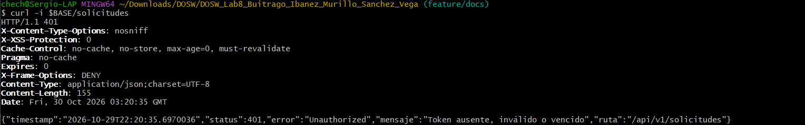
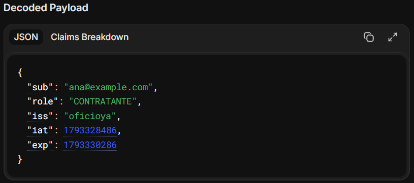
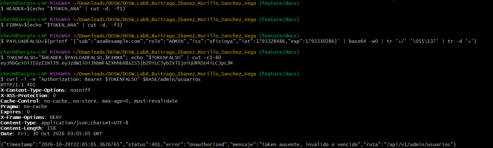
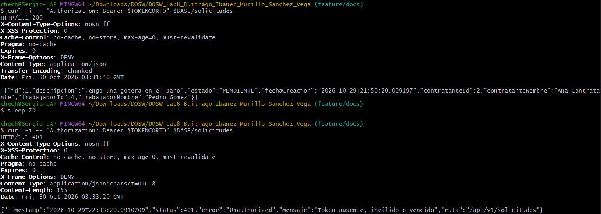
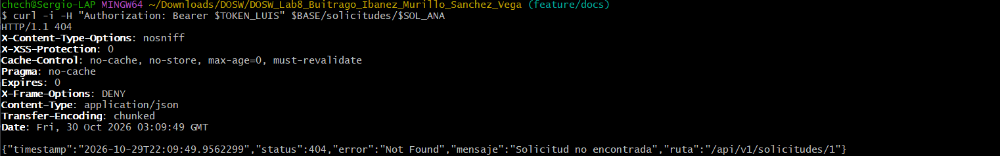
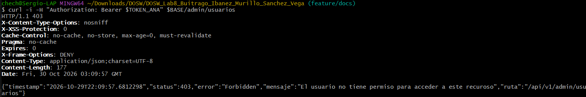
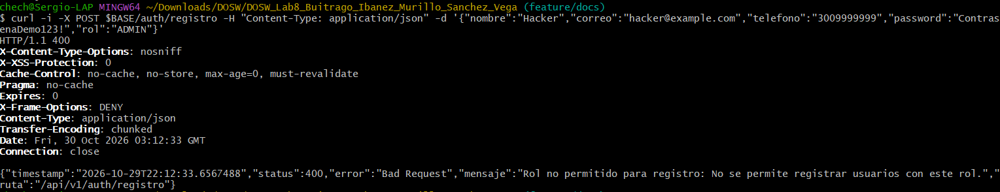
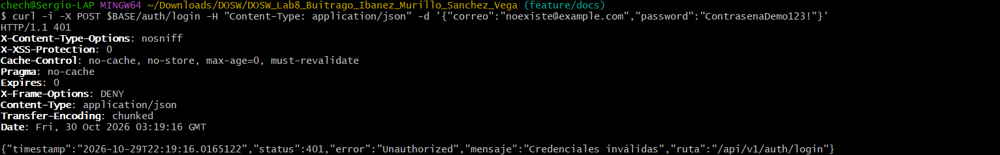

# Ataques manuales · Bloque 8
 
## Entorno
 
- Aplicación ejecutada en local con el perfil `dev` (`SPRING_PROFILES_ACTIVE=dev mvn spring-boot:run`) y PostgreSQL 17 en Docker.
- Variables cargadas desde `.env` (no versionado): `DB_PASSWORD`, `JWT_SECRET` (64 caracteres, generado con `openssl rand -base64 48`), `ADMIN_CORREO` y `ADMIN_PASSWORD`.
- Cliente: `curl` desde Git Bash.
- Usuarios de prueba:
 
| Usuario | Rol | Uso |
|---|---|---|
| `ana@example.com` | `CONTRATANTE` | Autora de la solicitud 1 |
| `luis@example.com` | `CONTRATANTE` | Atacante sobre la solicitud de Ana |
| `pedro@example.com` (id 4) | `TRABAJADOR` | Trabajador asignado a la solicitud 1 |
| `ADMIN_CORREO` | `ADMIN` | Creado por `AdminSeeder` solo en el perfil `dev` |
 
Los tokens se guardaron en variables de la terminal y en este documento solo se muestran recortados.
 
## Resumen
 
| # | Ataque | Esperado | Obtenido | Evidencia |
|---|---|---|---|---|
| 1 | Pedir `/solicitudes` sin token | `401` | `401` · "Token ausente, inválido o vencido" | [respuesta-401](evidence/respuesta-401.png) |
| 2 | Cambiar `role` a `ADMIN` en el token | `401` | `401` · "Token ausente, inválido o vencido" | [jwt-payload](evidence/jwt-payload.png), [ataque-2](evidence/ataque-2.png) |
| 3 | Usar un token vencido (duración de 1 minuto) | `401` | `200` recién emitido y `401` después de 70 s | [ataque-3](evidence/ataque-3.png) |
| 4 | Con el token de Luis, pedir la solicitud de Ana | `404` | `404` · "Solicitud no encontrada" | [ataque-4](evidence/ataque-4.png) |
| 5 | Con un contratante, llamar a `/admin/usuarios` | `403` | `403` · "El usuario no tiene permiso para acceder a este recurso" | [respuesta-403](evidence/respuesta-403.png) |
| 6 | Registrarse con `"rol": "ADMIN"` | `400` | `400` · "Rol no permitido para registro" | [ataque-6](evidence/ataque-6.png) |
| 7 | Login con correo inexistente y con clave errónea | Mismo `401` y mismo mensaje | `401` · "Credenciales inválidas" en ambos casos | [ataque-7](evidence/ataque-7.png) |
 
Todos los ataques obtuvieron la respuesta esperada, y todas las respuestas de error usan el formato único `ApiError` (`timestamp`, `status`, `error`, `mensaje`, `ruta`).
 
## Preparación de datos
 
```bash
BASE=http://localhost:8080/api/v1
 
# Registro de usuarios
curl -s -X POST $BASE/auth/registro -H "Content-Type: application/json" \
  -d '{"nombre":"Ana Contratante","correo":"ana@example.com","telefono":"3001111111","password":"ContrasenaDemo123!","rol":"CONTRATANTE"}'
curl -s -X POST $BASE/auth/registro -H "Content-Type: application/json" \
  -d '{"nombre":"Luis Contratante","correo":"luis@example.com","telefono":"3002222222","password":"ContrasenaDemo123!","rol":"CONTRATANTE"}'
curl -s -X POST $BASE/auth/registro -H "Content-Type: application/json" \
  -d '{"nombre":"Pedro Gomez","correo":"pedro@example.com","telefono":"3001234567","password":"ContrasenaDemo123!","rol":"TRABAJADOR","oficioPrincipal":"Plomero","zona":"Chapinero"}'
 
# Login y tokens (se guardan en variables, no se muestran completos)
TOKEN_ANA=$(curl -s -X POST $BASE/auth/login -H "Content-Type: application/json" \
  -d '{"correo":"ana@example.com","password":"ContrasenaDemo123!"}' | sed -E 's/.*"accessToken":"([^"]+)".*/\1/')
TOKEN_LUIS=$(curl -s -X POST $BASE/auth/login -H "Content-Type: application/json" \
  -d '{"correo":"luis@example.com","password":"ContrasenaDemo123!"}' | sed -E 's/.*"accessToken":"([^"]+)".*/\1/')
 
# Ana crea una solicitud para Pedro (id 4); el contratante sale del token, no del cuerpo
SOL_ANA=$(curl -s -X POST $BASE/solicitudes -H "Authorization: Bearer $TOKEN_ANA" -H "Content-Type: application/json" \
  -d '{"trabajadorId":4,"descripcion":"Tengo una gotera en el bano"}' | sed -E 's/.*"id":([0-9]+).*/\1/')
# SOL_ANA = 1
```
 
## Detalle
 
### Ataque 1 · Pedir `/solicitudes` sin token
 
```bash
curl -i $BASE/solicitudes
```
 
```http
HTTP/1.1 401
Content-Type: application/json;charset=UTF-8
 
{"timestamp":"2026-10-29T22:20:35.6970036","status":401,"error":"Unauthorized","mensaje":"Token ausente, inválido o vencido","ruta":"/api/v1/solicitudes"}
```
 
Sin cabecera `Authorization`, el `SecurityContext` queda vacío y `JsonAuthenticationEntryPoint` responde `401` con `ApiError`. Solo `/api/v1/auth/**` es público.
 

 
### Ataque 2 · Cambiar `role` a `ADMIN`
 
1. Se decodificó el token de Ana en jwt.io. El payload contiene solo `sub`, `role`, `iss`, `iat` y `exp`, sin contraseña ni teléfono, y la cabecera indica `HS256`:
 

 
2. Se construyó un token con el payload alterado (`"role":"ADMIN"`), conservando la cabecera y la **firma original** de Ana, como haría un atacante que no conoce la clave:
 
```bash
HEADER=$(echo "$TOKEN_ANA" | cut -d. -f1)
FIRMA=$(echo "$TOKEN_ANA" | cut -d. -f3)
PAYLOAD_FALSO=$(printf '{"sub":"ana@example.com","role":"ADMIN","iss":"oficioya","iat":1793328486,"exp":1793330286}' \
  | base64 -w0 | tr '+/' '-_' | tr -d '=')
TOKEN_FALSO="$HEADER.$PAYLOAD_FALSO.$FIRMA"
# eyJhbGciOiJIUzI1NiJ9.eyJzdWIiOiJhbmFAZXhhbXBsZS5jb20iLCJyb2xlIjoiQURNSU4i...
 
curl -i -H "Authorization: Bearer $TOKEN_FALSO" $BASE/admin/usuarios
```
 
```http
HTTP/1.1 401
Content-Type: application/json;charset=UTF-8
 
{"timestamp":"2026-10-29T22:05:05.3626765","status":401,"error":"Unauthorized","mensaje":"Token ausente, inválido o vencido","ruta":"/api/v1/admin/usuarios"}
```
 
El servidor recalcula la firma HS256 del contenido recibido con su `JWT_SECRET`. Como el payload cambió, la firma ya no coincide y `JwtService.validar` lanza `JwtException`, así que el filtro no autentica la petición. Sin conocer la clave no es posible generar una firma válida para el payload alterado.
 

 
### Ataque 3 · Token vencido
 
Se reinició la aplicación con una duración de 1 minuto, sin modificar `application.properties`:
 
```bash
mvn spring-boot:run -Dspring-boot.run.profiles=dev -Dspring-boot.run.arguments=--app.jwt.ttl-minutes=1
```
 
```bash
TOKEN_CORTO=$(curl -s -X POST $BASE/auth/login -H "Content-Type: application/json" \
  -d '{"correo":"ana@example.com","password":"ContrasenaDemo123!"}' | sed -E 's/.*"accessToken":"([^"]+)".*/\1/')
 
# Recién emitido
curl -i -H "Authorization: Bearer $TOKEN_CORTO" $BASE/solicitudes
 
sleep 70
 
# Pasado el minuto
curl -i -H "Authorization: Bearer $TOKEN_CORTO" $BASE/solicitudes
```
 
Recién emitido:
 
```http
HTTP/1.1 200
Content-Type: application/json
 
[{"id":1,"descripcion":"Tengo una gotera en el bano","estado":"PENDIENTE","fechaCreacion":"2026-10-29T21:50:20.009197","contratanteId":2,"contratanteNombre":"Ana Contratante","trabajadorId":4,"trabajadorNombre":"Pedro Gomez"}]
```
 
Después de 70 segundos:
 
```http
HTTP/1.1 401
Content-Type: application/json;charset=UTF-8
 
{"timestamp":"2026-10-29T22:33:20.0910209","status":401,"error":"Unauthorized","mensaje":"Token ausente, inválido o vencido","ruta":"/api/v1/solicitudes"}
```
 
El mismo token pasa de `200` a `401` solo por haber superado su `exp`: la expiración se valida en cada petición. Al terminar, la aplicación se reinició con la duración normal de 30 minutos.
 

 
### Ataque 4 · Token de Luis sobre la solicitud de Ana
 
```bash
curl -i -H "Authorization: Bearer $TOKEN_LUIS" $BASE/solicitudes/$SOL_ANA
```
 
```http
HTTP/1.1 404
Content-Type: application/json
 
{"timestamp":"2026-10-29T22:09:49.9562299","status":404,"error":"Not Found","mensaje":"Solicitud no encontrada","ruta":"/api/v1/solicitudes/1"}
```
 
La consulta `findByIdAndParticipante` incluye al usuario autenticado. Para Luis, la solicitud 1 no existe, y recibe el mismo `404` y el mismo mensaje que con un id inexistente. Se responde `404` y no `403` para no confirmar que la solicitud existe. Con el token de Ana la misma petición responde `200`, como se ve en el ataque 3.
 

 
### Ataque 5 · Contratante en `/admin/usuarios`
 
```bash
curl -i -H "Authorization: Bearer $TOKEN_ANA" $BASE/admin/usuarios
```
 
```http
HTTP/1.1 403
Content-Type: application/json;charset=UTF-8
 
{"timestamp":"2026-10-29T22:09:57.6812298","status":403,"error":"Forbidden","mensaje":"El usuario no tiene permiso para acceder a este recurso","ruta":"/api/v1/admin/usuarios"}
```
 
El token es válido, así que el servidor sabe quién es Ana, pero su rol `CONTRATANTE` no cumple `hasRole('ADMIN')`. `JsonAccessDeniedHandler` responde `403` con `ApiError`.
 

 
### Ataque 6 · Registro con `"rol": "ADMIN"`
 
```bash
curl -i -X POST $BASE/auth/registro -H "Content-Type: application/json" \
  -d '{"nombre":"Hacker","correo":"hacker@example.com","telefono":"3009999999","password":"ContrasenaDemo123!","rol":"ADMIN"}'
```
 
```http
HTTP/1.1 400
Content-Type: application/json
 
{"timestamp":"2026-10-29T22:12:33.6567488","status":400,"error":"Bad Request","mensaje":"Rol no permitido para registro: No se permite registrar usuarios con este rol.","ruta":"/api/v1/auth/registro"}
```
 
El registro solo acepta los roles de una lista de permitidos (`TRABAJADOR`, `CONTRATANTE`). El `ADMIN` solo se crea con `AdminSeeder` en el perfil `dev`.
 

 
### Ataque 7 · Login con correo inexistente y con clave errónea
 
```bash
# Correo que no existe
curl -i -X POST $BASE/auth/login -H "Content-Type: application/json" \
  -d '{"correo":"noexiste@example.com","password":"ContrasenaDemo123!"}'
 
# Correo existente con contraseña incorrecta
curl -i -X POST $BASE/auth/login -H "Content-Type: application/json" \
  -d '{"correo":"ana@example.com","password":"ClaveEquivocada999!"}'
```
 
Correo inexistente:
 
```http
HTTP/1.1 401
 
{"timestamp":"2026-10-29T22:19:16.0165122","status":401,"error":"Unauthorized","mensaje":"Credenciales inválidas","ruta":"/api/v1/auth/login"}
```
 
Contraseña incorrecta:
 
```http
HTTP/1.1 401
 
{"timestamp":"2026-10-29T22:20:08.7785264","status":401,"error":"Unauthorized","mensaje":"Credenciales inválidas","ruta":"/api/v1/auth/login"}
```
 
Los dos casos devuelven el mismo código y el mismo mensaje, así que un atacante no puede averiguar qué correos están registrados. Ninguna de las dos respuestas incluye token.
 

 
## Otras evidencias
 
| Evidencia | Archivo |
|---|---|
| Columna `password_hash` en PostgreSQL con hashes BCrypt (`$2a$10$...`), no texto plano | [password-hash](evidence/password-hash.png) |
| Resultado de `mvn clean verify` | [mvn-verify](evidence/mvn-verify.png) |
 
Consulta usada:
 
```bash
docker exec postgres-oficioya psql -U postgres -d oficioya_security -c "SELECT id, correo, rol, password_hash FROM usuarios;"
```
 
## Hallazgo durante las pruebas
 
Al crear una solicitud con la descripción "Tengo una gotera en el baño" desde Git Bash en Windows, la `ñ` se envió con una codificación distinta de UTF-8 y la API respondió `400`, como corresponde. Sin embargo, el `mensaje` de esa respuesta incluía el detalle interno del parser de Jackson y el nombre de la clase `edu.eci.dosw.oficioya.dto.SolicitudRequest`. Esto va contra RS-09 (errores sin trazas) y se relaciona con OWASP A10. Se registra como mejora: el manejador de `HttpMessageNotReadableException` en `ApiExceptionHandler` debe devolver un mensaje genérico, sin la causa interna.